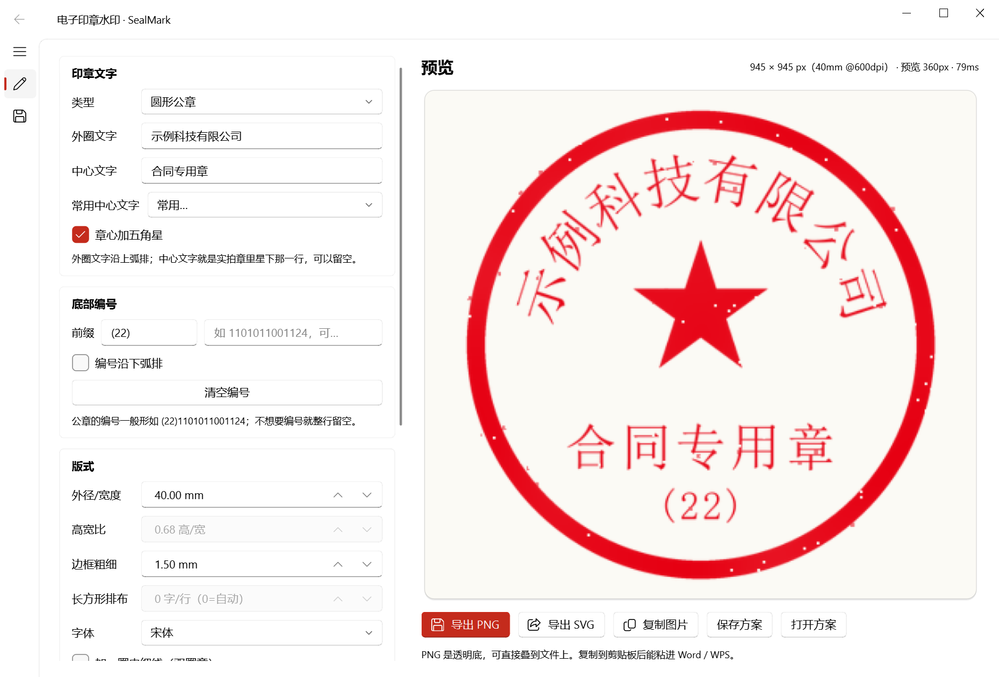
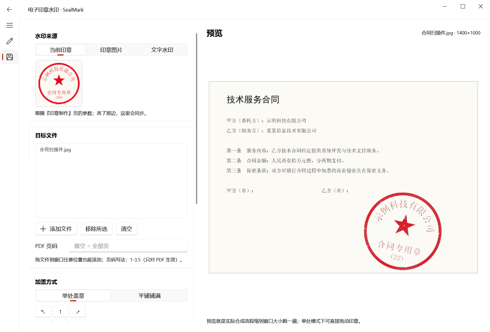

# SealMark · 电子印章水印

输入自己的文字，生成一枚印章，再把它盖到图片或 PDF 上。全程本地运行，不上传任何文件。

- **印章制作**：圆形公章 / 椭圆形章 / 长方形章，外圈弧排字、章心五角星、星下那一行（合同专用章、
  财务专用章…）、底部编号（`(22)1101011001124`）都能自己填；可调字号、跨度、边框、字体、印泥颜色、
  做旧强度。导出透明底 PNG、可直接编辑的 SVG，或复制到剪贴板粘进 Word / WPS。
- **加盖水印**：水印来源可以是「当前印章」「自己的印章图片（可自动抠白底）」「纯文字」；单处盖章或
  平铺铺满；位置、大小、角度、不透明度、间距可调，还能在预览上直接拖动。支持图片与 PDF 混批处理。
- **PDF 是叠加，不是转图**：文字层与矢量内容原样保留。





## 第一次运行

需要 Windows 自带中文字体（宋体、黑体等）与 Python 3.10+。

```bat
:: 1) 在项目目录建一个隔离虚拟环境（不污染全局 Python）
"C:\Users\<你>\AppData\Local\Programs\Python\Python313\python.exe" -m venv --system-site-packages .venv

:: 2) 装依赖（国内可用清华/阿里镜像）
.venv\Scripts\python.exe -m pip install -i https://mirrors.aliyun.com/pypi/simple Pillow pymupdf PySide6 PySide6-Fluent-Widgets
```

之后双击 **`run.bat`** 就能启动（用 `pythonw` 起，不弹黑框）。

## 印章参数怎么理解

| 参数 | 说明 |
| --- | --- |
| 外圈文字 | 沿上弧排列的单位名称，字太大/太挤时调「文字跨度」「外圈字号」 |
| 中心文字 | 实拍章里五角星下面那一行，例如「合同专用章」，可留空 |
| 底部编号 / 前缀 | 例如前缀 `(22)` + 编号 `1101011001124`；横排宽度会按章内弦长自动收缩，不会顶出外圈 |
| 编号沿下弧排 | 勾上后编号跟着下弧走（字顶朝圆心），不勾就是横排 |
| 做旧强度 | 随机吃掉一点墨、加些飞溅，像真盖上去的；要干净的矢量感就拖到 0 |
| 导出 SVG | 矢量版，文字仍是文字，能在 Illustrator / Inkscape 里改；`viewBox` 按毫米出图，可直接印 |

## 加盖水印怎么用

1. 选水印来源；「当前印章」会跟随印章页的参数实时更新。
2. 添加文件：**图片和 PDF 可以一起选**，也可以直接把文件拖进窗口。
3. 选布局：**单处盖章**（九宫格快捷定位，或直接在右侧预览上拖动）／**平铺铺满**（调间距与交错）。
4. 三个预设一键可用：`合同盖章`（右下 30% / -12° / 95%）、`背景水印`（居中 65% / -30° / 18%）、
   `平铺防伪`（30° 斜排、20% 浓淡）。
5. 处理 PDF 时填页码（`1-3,5`、`1、2`，留空 = 全部），然后点「开始处理」。

> 水印浓淡由「不透明度」控制：18% 是「看得见但不抢正文」的常规防伪浓度（实测 150dpi 下与 1:1 直接
> 合成的结果一致），想要更显眼就往 40% 以上拖。

输出文件名为 `原名_已盖章.后缀`，默认落在源文件同目录；**原始文件不会被改动**，重复处理会覆盖上一次的
输出（不会越攒越多）。

## 用脚本批量处理

界面之外的部分不依赖 Qt，可以直接写脚本：

```python
from sealmark.seal import SealSpec, render
from sealmark.stamp import StampOptions, stamp_file

spec = SealSpec(arc_text="示例科技有限公司", center_text="合同专用章",
                bottom_prefix="(22)", bottom_text="1101011001124")
mark = lambda width: render(spec, target_px=width)   # 按目标宽度现画，边缘更干净
opt = StampOptions(layout="single", x=0.72, y=0.78, width_ratio=0.30, angle=-12, opacity=0.95)

for path in ["合同.pdf", "扫描件.jpg"]:
    print(stamp_file(path, mark, opt, pages_expr="1-3"))
```

## 已知限制

- 带打开口令的 PDF 不支持（会在提示条上单独报错，不影响同批次其它文件）。
- 输出 JPEG 会重新编码一次（质量 95）；想要无损请用 PNG。
- 印章字体取自系统字体，换机器时如果缺某款字体会自动回退到宋体/黑体。
- 做旧是逐像素随机，同样的「种子」结果可复现；点「换一种做旧」换种子。

## 目录结构

```
app.py                 入口（双击 run.bat 走这里）
sealmark/seal.py       印章渲染：比例排版 + 墨迹蒙版 + 做旧（纯 PIL，不依赖 Qt）
sealmark/svg.py        矢量导出（与光栅版共用同一批版式常量）
sealmark/stamp.py      加盖：图片合成 + PDF 叠加层 + 页码解析
sealmark/specs.py      方案 JSON 与设置持久化
sealmark/gui/          Qt 界面（唯一依赖 PySide6 的一层）
tools/make_icon.py     用印章渲染器画应用图标
tests/                 55 条用例：尺寸/透明底/确定性/弧排方向/PDF 文字层与几何
```

## 开发门禁

```powershell
pwsh -File scripts/check.ps1      # ruff check + ruff format --check + pytest
```
